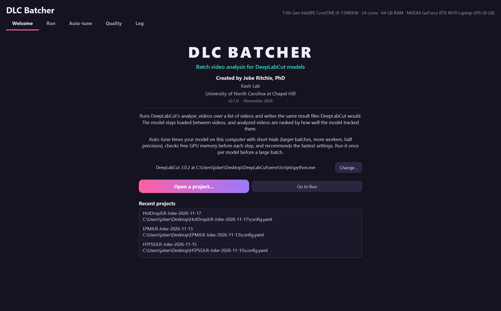
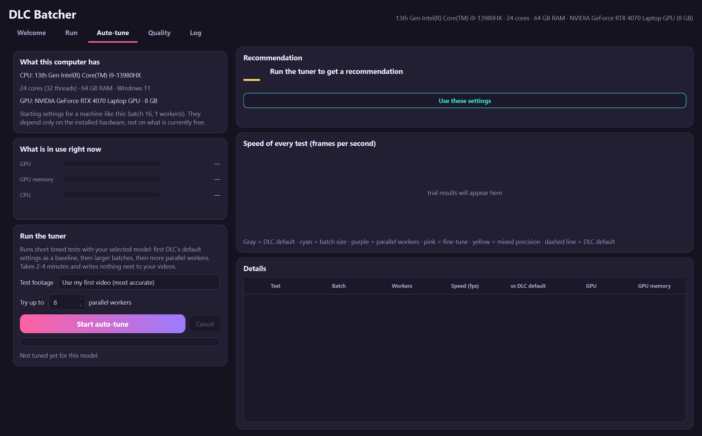
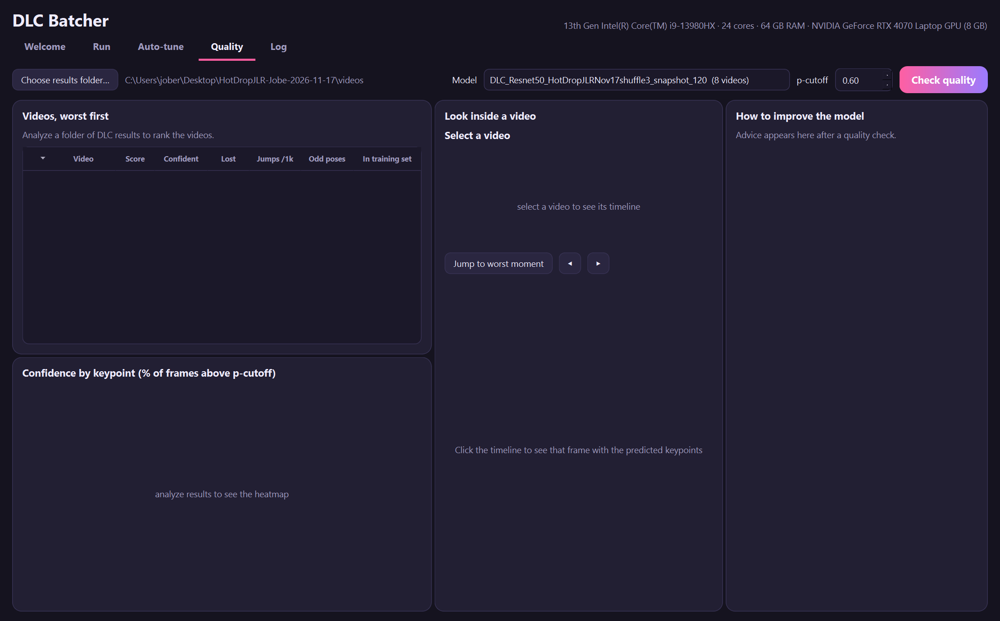

# DLC Batcher

Batch video analysis for existing [DeepLabCut](https://github.com/DeepLabCut/DeepLabCut)
models. Point it at a project and a list of videos; it runs DeepLabCut's own
`analyze_videos` on each one, shows progress and tracking confidence while it
works, and afterwards ranks the videos by how well the model tracked them.

Auto-tune finds the fastest settings for your computer and your model. It runs
short timed trials on a few seconds of video: the project's default batch size
as a baseline, then larger batches, more parallel workers, and half precision.
It reports the frames per second of each trial, recommends a batch size and
worker count, and applies them to the Run tab with one click. Before each step
it checks free GPU memory, so it backs off instead of running out of memory or
disturbing another program on the same GPU. The result is saved per GPU, network
and frame size, so you tune once per model.

The `.h5`, `.pickle` and `.csv` files are written by DeepLabCut itself, so they
are the same files a normal DeepLabCut run produces.



## Requirements

- Windows with a Python environment that has DeepLabCut 3 installed (conda or
  venv). DeepLabCut brings PySide6, OpenCV, pandas and psutil, so there is
  nothing else to install.
- Tested with DeepLabCut 3.0.0rc8 and 3.0.2 (PyTorch engine). Other versions
  may work; the app warns when it runs on one it was not tested with.
- TensorFlow-engine models run with progress reporting only. That path is
  untested.

## Starting it

Double-click `DLC Batcher.bat`. It looks for your DeepLabCut environment in this
order:

1. the `DLC_BATCHER_PYTHON` environment variable (full path to a `python.exe`),
2. the environment you chose in the app last time,
3. conda environments (`anaconda3`, `miniconda3`, `miniforge3`, `mambaforge`
   under your user folder or `ProgramData`) and venvs in `Desktop\DeepLabCut\venv`,
   `%UserProfile%\DeepLabCut\venv`, or `.venv` / `venv` next to the app. If
   several have DeepLabCut, the newest version is used,
4. if nothing is found, it asks for the path to `python.exe` and remembers it.

Or start it yourself from the DeepLabCut environment:

```
python -m dlc_batcher
```

The Welcome page shows which DeepLabCut is in use. "Change…" lists every
environment that was found and lets you browse to another one. The choice is
stored in `%UserProfile%\.dlc_batcher\settings.json`.

## Updates

Install with `git clone` so the app can update itself. On start it checks the
GitHub repository in the background. When a newer version exists, a bar appears
at the top with "Update and restart": it fast-forwards the checkout and reopens
the app. Files you edited in the app folder are never overwritten; the update
stops and tells you instead. "Check for updates" in the header runs the check
on demand. Git for Windows is required for this.

## Using it

Run tab:

1. Pick the project (its folder or `config.yaml`), then the shuffle and snapshot.
2. Add videos: files, a folder, or drag and drop.
3. Set batch size, number of workers, device, output folder, whether to skip or
   overwrite existing results, CSV output, cropping.
4. Start. The dashboard shows runtime, time left, speed, videos and frames done,
   GPU / memory / CPU load, one row per worker, and the share of keypoints above
   the p-cutoff as results come in.


Auto-tune times your model on this computer: the project's default batch size
first, then larger batches, more workers, and half precision. It suggests
settings and stores the result per GPU, network and frame size. It uses your
first video or a bundled synthetic clip and writes nothing next to your videos.
If another program is using the GPU, it stays within the free memory and marks
the result as measured on a busy GPU.



Quality opens after a run, or on any folder of DeepLabCut results. Each video
gets a 0-100 score from four signals:

| Signal | Weight | Meaning |
|---|---|---|
| Confident keypoints | 50 % | share of detections above the p-cutoff |
| Jumps | 20 % | a confident keypoint moving more than 30 % of a body length in one frame |
| Odd poses | 15 % | keypoint distances far from their usual value |
| Lost frames | 15 % | frames with no keypoint above the p-cutoff |

There is no ground truth for a new video, so the score is a guide to which
videos to look at, not an accuracy measurement. The tab lists weak keypoints and
videos worth extracting outlier frames from, and clicking a video's timeline
shows that frame with the predicted keypoints.



## What it changes, and what that is worth

Measured on one laptop: RTX 4070 Laptop GPU (8 GB), i9-13980HX, DeepLabCut
3.0.2, ResNet-50 bottom-up model with 7 keypoints, 344x328 video. Each row is
the first 9,000 frames of one video, one worker, GPU otherwise idle. Repeated
runs varied by about 8 %, partly from laptop thermals.

| Setting | Frames/s | GPU load |
|---|---|---|
| DeepLabCut code path, batch 8 | 186 | 95 % |
| DeepLabCut code path, batch 16 | 156-168 | 96 % |
| Batch 32 / 64 | 153 / 155 | 97 % |
| Half precision, batch 16 | 253-288 | 91 % |
| Half precision, batch 32 / 64 | 277 / 274 | 95 % |
| DeepLabCut's `autocast`, batch 32 | 145 | 97 % |
| `channels_last`, batch 32 | 107 | 98 % |
| Half precision, two workers | 239 (one worker: 247) | 93 % |

What this says for that machine and model:

- The GPU is the limit. It sat at 91-97 % while the CPU averaged about 10 % of
  32 threads, so a larger batch, a deeper frame queue, cuDNN autotuning and a
  second worker did not help.
- Half precision (the whole model in 16-bit) is the one setting that mattered,
  about 1.7x. It is off by default because it changes the output slightly, see
  below.
- With half precision and a batch of 4 or 8 the GPU dropped to 37-61 % and speed
  fell, so keep the batch at 16 or more.
- Time between videos is small. Over three full videos (106,502 frames, batch
  16, 32-bit) inference took 683 s, opening the videos 0.5 s and writing results
  6.3 s, so there is about 1 % to gain from overlapping them with inference.
- `torch.compile` did not run on this Windows install.

DeepLabCut 3.0.2 already prepares frames on a second thread and decodes
keypoints a batch at a time, so the app adds no pipeline changes there. On
3.0.0rc8 it still installs its own versions of both; the same test gave 107
frames/s without them, 157 with them and 253 with half precision.

How much the output moves (9,000 frames, 63,000 keypoints, compared with batch
16 in 32-bit):

| Change | Mean shift | Keypoints moved > 1 px |
|---|---|---|
| Same settings, run again | 0 px | 0 % |
| Batch 8 or 64 instead of 16 | 0.12-0.14 px | 0.14-0.17 % |
| Half precision | 0.39-0.45 px | 0.50-0.52 % |

99 % of keypoints moved less than 0.05 px in every case. The few large shifts
are keypoints whose heatmap has two near-equal peaks.

Other models, frame sizes and GPUs will give different numbers. Auto-tune
reports yours.

## Notes

- A failed video is retried once on a freshly loaded model. Out-of-memory
  errors are not retried.
- Dynamic cropping forces batch size 1 (a DeepLabCut rule).
- Default settings depend only on the hardware (GPU memory, cores), never on
  what happens to be free when the app starts.
- Progress reporting and the half-precision option rely on hooks into
  DeepLabCut internals (`dlc_batcher/worker.py`). A new DeepLabCut release may
  need them updated.

## Layout

```
dlc_batcher/
  worker.py       analysis process: calls DeepLabCut, reports progress
  engine.py       starts workers, hands out videos, speed and time left
  dlc_env.py      finds the DeepLabCut environment
  calibration.py  auto-tune
  hardware.py     hardware detection and load sampling
  quality.py      per-video metrics, scores, advice
  project.py      reads a DeepLabCut project without importing DeepLabCut
  gui/            Welcome, Run, Auto-tune and Quality tabs
tests/            python -m pytest (no GPU or DeepLabCut needed)
```

## License

MIT. Created by Jobe Ritchie, PhD, Kash Lab, University of North Carolina at
Chapel Hill.
