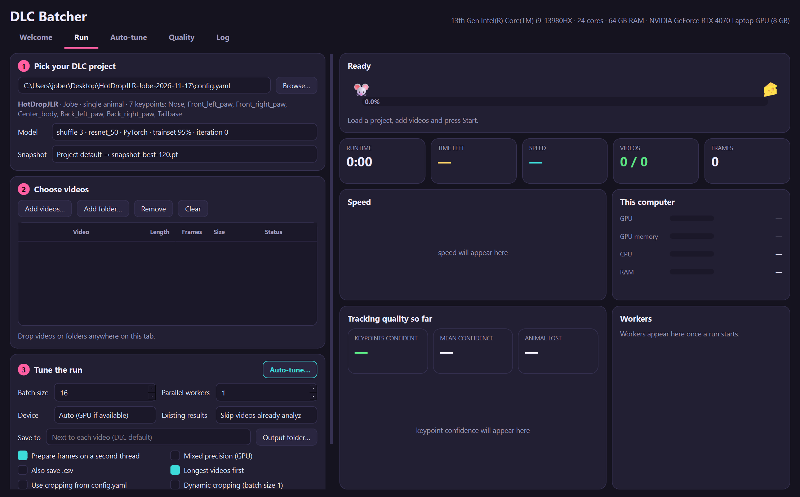

# DLC Batcher

Batch video analysis for [DeepLabCut](https://github.com/DeepLabCut/DeepLabCut)
models. It runs DeepLabCut's own `analyze_videos` on a list of videos, so the
output files are the ones DeepLabCut writes.

It was built mainly for Auto-tune: the fastest batch size, worker count and
precision differ from one computer to the next, so the app measures them on
yours instead of guessing.

- **Run**: pick a project and videos, watch progress and tracking confidence.
- **Auto-tune**: times batch size, worker count and half precision on your
  computer and suggests the fastest settings.
- **Quality**: ranks analyzed videos by how well the model tracked them.



## Install

Needs Windows, Git, and a Python environment with DeepLabCut 3 (tested with
3.0.0rc8 and 3.0.2, PyTorch engine).

```
git clone https://github.com/JobeRitchie/DLC-Batcher.git
```

Double-click `DLC Batcher.bat`. It finds your DeepLabCut environment (conda or
venv) and asks for the path to `python.exe` if it can't. To use a specific one,
set `DLC_BATCHER_PYTHON` or use "Change…" on the Welcome page.

The app checks for new versions on start and can update itself.

## Speed

One laptop (RTX 4070 Laptop GPU, ResNet-50, 7 keypoints, 344x328 video,
DeepLabCut 3.0.2), 9,000 frames:

| Setting | Frames/s |
|---|---|
| Batch 8 / 16 / 32 / 64 | 186 / 156-168 / 153 / 155 |
| Half precision, batch 16 | 253-288 |
| Half precision, two workers | 239 |

The GPU was the limit, so only half precision helped. It is off by default
because it shifts keypoints slightly (0.4 px on average, 0.5 % by more than
1 px). Your numbers will differ; Auto-tune measures them.

## Notes

- TensorFlow-engine models are untested.
- Dynamic cropping forces batch size 1.
- A failed video is retried once.
- Tests: `python -m pytest`

MIT license. Jobe Ritchie, PhD, Kash Lab, University of North Carolina at
Chapel Hill.
